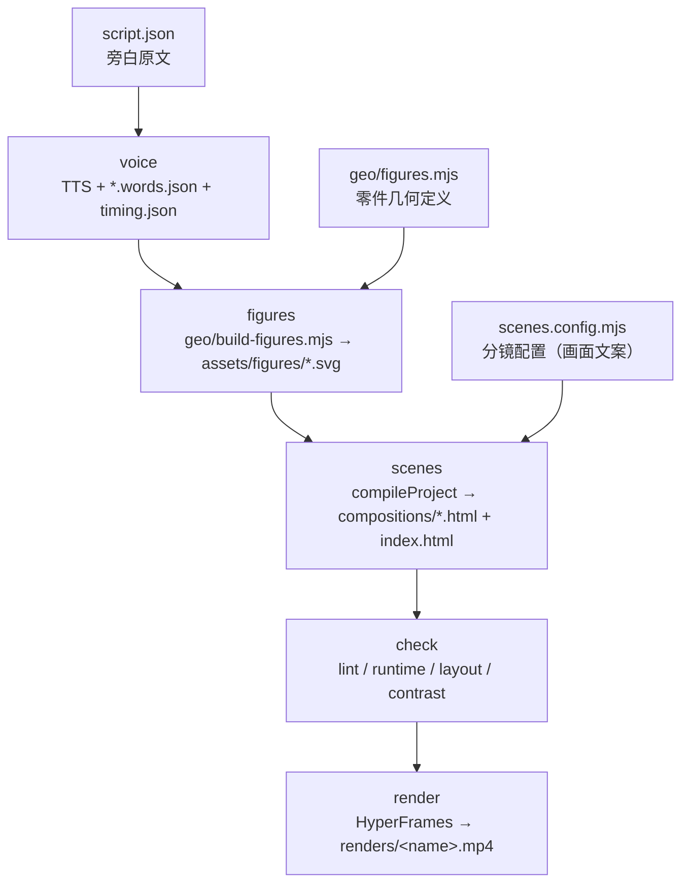

# 技术架构与视频生成流程

> **文档定位**：`anatomy-hyperframes-video` 的架构说明与流水线拆解（Architecture & Pipeline）
> **读者**：接手本项目的工程师 / Agent
> **与另一份文档的关系**：`docs/多工作区沙箱升级.md` 记录的是"从单租户到多工作区"的**一次重构决策与验收**（历史）；本文描述的是**重构后的稳态架构**（现状），并在最后给出留档的隐患清单。
> **核对基线**：commit `0610708`，本文所有行号与该 commit 一致。

---

## 一、它是什么

一句话：**用 Anatomy 把机械结构画成等轴测爆炸图（静态 SVG），用 HyperFrames 把 HTML 逐帧渲染成视频（精确时间轴 + 配音 + 字幕）。**

这条流水线解决的核心问题不是"能不能画图"，而是**同一条流水线要能稳定产出第 N 部视频**，而不是每次重写一遍脚本。因此工程的真正主题是：**通用能力（core）与业务数据（projects/<name>）的物理分离**。

两条硬约束决定了整个设计：

1. **渲染必须可复现** —— HyperFrames 拿到的东西必须是**已经落盘的静态 HTML**，渲染期不再跑 python、不再算几何。
2. **每个视频必须互不污染** —— HyperFrames 会在项目根烧 `.hyperframes/` 缓存、按相对路径找资源；两套视频共用根目录必然串味。

对应两个决策：**编译期定稿** + **一个视频一个沙箱**。

---

## 二、仓库拓扑

```text
anatomy-hyperframes-video/
├── core/                                  ← 通用引擎（零业务逻辑）
│   ├── config.mjs                   (57)   Chrome 动态嗅探 / puppeteer 锁清理 / 路径解析
│   ├── tts/engine.py               (402)   双轨 TTS + 多音字解耦 + 字幕切分对齐
│   ├── generator/compiler.mjs      (290)   分镜 HTML 编译器 + 根时间轴组装
│   └── styles/lib.mjs              (238)   等轴测几何与材质库（frustum / matCss）
├── bin/video.mjs                   (169)   ★ 唯一编排入口，所有命令走 --project
├── projects/<name>/                        ← 视频沙箱（自闭环）
│   ├── project.json                        元数据：分辨率 / fps / 音色 / 主题
│   ├── script.json                         台词（旁白原文 + 音色）
│   ├── scenes.config.mjs                   分镜配置（画面文案 / 零件清单 / 图形引用）
│   ├── geo/                                该视频专属几何与装配代码
│   │   ├── lib.mjs                         re-export core/styles/lib.mjs
│   │   ├── figures.mjs                     零件图定义（键盘）
│   │   ├── build-figures.mjs               出图入口 → assets/figures/*.svg
│   │   └── gen-scenes.mjs                  手工调试用直调 compiler（10 行 shim）
│   ├── assets/
│   │   ├── figures/*.svg                   生成的矢量图（机器产物）
│   │   └── voice/                          TTS 音频 + words.json + timing.json + manifest.json
│   ├── compositions/*.html                 生成的分镜（机器产物）
│   ├── index.html                          生成的根时间轴（机器产物）
│   ├── preview/                            快照 / golden master
│   └── renders/*.mp4                       成片
├── docs/                                  架构与重构文档
└── skill/anatomy-hyperframes-workflow/    沉淀的可复用 skill（SKILL.md + 4 篇 reference + 9 个模板）
```

**当前两个租户**

| 项目 | 场景数 | 音频来源 | 成片 |
| :--- | :---: | :--- | :--- |
| `mechanical-keyboard` | 9（已全部出图出镜） | MiMo-v2.5-TTS（9/9） | `renders/mechanical_keyboard_anatomy.mp4`（17.7 MB） |
| `anc-headphones` | 2（配置 2 个，脚本 10 段台词） | Edge-TTS（2/2） | `renders/anc-headphones.mp4`（4.2 MB） |

`projects/_template/` 只有 `project.json` / `scenes.config.mjs` / `script.json` 三个文件，没有 `geo/build-figures.mjs` —— 见第五节隐患 6。

---

## 三、七个技术要点

### 1. 编排器只是一个薄调度器

`bin/video.mjs` 169 行，全部职责是：解析 `--project` → 定位沙箱 → 起子进程。它**不含任何业务逻辑**，也不做 HTML 拼接。

启动时先做两件事（`bin/video.mjs:18-22`）：

```js
const chromePath = resolveChromePath();
if (chromePath) {
  process.env.HYPERFRAMES_BROWSER_PATH = chromePath;
  process.env.PRODUCER_HEADLESS_SHELL_PATH = chromePath;
}
const HF_CLI = resolveHyperFramesCli();
```

子命令全部通过 `execFileSync` 起外部进程，且**一律 `cwd: PROJ_DIR`**：

```js
execFileSync("node", [HF_CLI, "check", "."], { cwd: PROJ_DIR, stdio: "inherit", env: process.env });
```

这条 `cwd` 绑定是架构级约束，不是风格偏好 —— HyperFrames 用相对路径找 `assets/`、并把缓存写进当前目录的 `.hyperframes/`，`cwd` 一旦错位，资源与缓存就落到别的沙箱里去。

`core/config.mjs` 的三个函数各自对应一个踩过的坑：

| 函数 | 解决的问题 |
| :--- | :--- |
| `resolveChromePath()` | 曾把 Chrome 版本路径写死，缓存清理后全线崩。现在优先 `HYPERFRAMES_BROWSER_PATH`，否则扫 `~/.cache/hyperframes/chrome/chrome-headless-shell/<version>/`。 |
| `cleanTempProfiles()` | 清 `%TEMP%/puppeteer_dev_chrome_profile-*`，否则 Windows 上残留锁导致进程死等。`check`/`snapshot`/`render` 前都会调。 |
| `resolveProjectDir(name)` | 把 `--project` 映射为物理路径，不存在直接抛错（`--project` 打错不会静默回退）。 |

### 2. 双轨 TTS：能对齐的不好听，好听的对不齐

`core/tts/engine.py` 处理的是一对无法同时满足的需求：**词级时间戳只有 Edge-TTS 给得出，商业级音质只有 MiMo 给得出。**

| | preview | production |
| :--- | :--- | :--- |
| 引擎 | Edge-TTS `zh-CN-YunxiNeural`，`rate="+8%"` | MiMo-v2.5-TTS（`茉莉` / `苏打`） |
| 输出 | `.preview.mp3` | `.mimo.mp3` → ffmpeg 转 44.1kHz / 192k |
| 时间戳 | `boundary="WordBoundary"`，`chunk["offset"] / 10**7` 得秒级 word start/end | **没有**，靠比例拉伸 |
| 成本 | 零成本、秒级 | 需 `MIMO_API_KEY` |

关键在 `scale_timestamps(words, edge_dur, dst_dur)`（`core/tts/engine.py:164`）：拿 Edge 音轨上测得的词边界，**按整段时长比例整体缩放**到 MiMo 音轨上。MiMo 请求失败时优雅降级回 Edge（`final_source = "edge-tts (fallback)"`），保证流水线永不中断。

`timing.json` 的 `source` 字段记录了每段最终用了哪个引擎 —— 键盘项目 9 段全是 `mimo-v2.5-tts`，耳机项目当前 2 段是 `edge-tts`。

**多音字解耦**（`engine.py:21-46`）是这个文件里最巧的一处。中文 TTS 会把"弹片"念成武器弹药（dàn piàn），而机械键盘语境要念 tán piàn。解法是**音画解耦**：

```python
PRONUNCIATION_OVERRIDES = {
    "两片金属弹片": "两片金属谈片",
    "两片弹片": "两片谈片",
    "金属弹片": "金属谈片",
    "弹片": "谈片",
}
```

- `to_phonetic_text()`：送进 TTS 的是同音字"谈片"，发音 100% 正确；
- `restore_display_words()`：词边界缓存 `.words.json` 落盘前**再换回规范字**，保证字幕与时间轴元数据里出现的是"弹片"。

> **约束**：新增术语纠偏必须同时改这两张表，否则 `words.json` 里会留下"谈片"这种错字脏数据。

### 3. 字幕：从字级时间戳反推句子区间

`align_subtitles()`（`engine.py:214`）不使用固定间隔拍字幕。真实做法：

1. `split_sentences()` 按 `。！？；` 切句，再用 `，` 把超 20 字的长句拆短；
2. 把每个 word 按字符均分成时间片，拼成 `char_timeline`（每字一个 `start/end`）；
3. 对每句，从 `curr_idx` 起在 `char_timeline` 里**顺序前向匹配**每个字，取首字 start、末字 end；
4. `s_start = max(last_end, first.start)` —— 强制句子不重叠，避免字幕打架；
5. 无时间戳时退化成按字符数比例分配。

于是字幕的起落点直接锚在真实发音上，而不是"每秒换一张"。

### 4. Anatomy 等轴测：为什么自写 `frustum` 而不直接用 `extrude`

`core/styles/lib.mjs:1` 引入 Anatomy 的 kit：

```js
import * as K from "../../../anatomy/kit/iso-kit.mjs";
```

自写 `frustum(bottom, top, z0, z1, P)` 的唯一理由是：kit 的 `extrude()` 只支持**等截面**棱柱，而键帽是上小下大的锥台、外壳有倒角收口。`frustum` 接受两个尺寸不同的环，其余光照与描边逻辑完全照抄 kit 的规则：

- 法线 `counter ? [dy/L, -dx/L] : [-dy/L, dx/L]`，`facing = n·v > 1e-9`；
- 光照 `l = [-sinA, cosA]`，`lit = (n·l + 1) / 2`，`shade = clamp(floor(lit*4), 0, 3)`；
- 可见面进 `buckets[shade]`，被遮挡面进 `back`（供透明外壳之类的双层效果）；
- `fill` 用 `convexHull([...tp, ...bp])` 兜底，`top` 用 `orient(tp)`。

`area / orient / runsOf / convexHull` 是抄来的，因为这些在 kit 里**没有导出**（已实测：`tenth`/`thousandth`/`oriented`/`convexHull`/`runsOf`/`signedArea` 全部 `false`，只有 `extrude` 等是 `true`）。

`matCss()` 生成 `.m-<material>` 材质规则，有三个不写就崩的细节：

1. **每个材质要带 `[data-lit]` / `[data-seamless]` 属性变体** —— kit 的 `.iso-solid[data-lit]>.iso-fill` 特异性是 0,3,0，普通 `.m-x .iso-fill`（0,2,0）压不住；
2. **必须补 4 条基础规则**：`.iso-line / .iso-edge / .iso-crease { fill: none; stroke-linecap: round; ... }`。漏掉 `fill:none`，所有描边路径会被默认填黑，整张图变成一团黑块 —— 这是本项目最出名的一次 bug；
3. **CSS 自定义属性 `var()` 在 SVG 光栅化链路里不可靠**，涉及离线预览/DOM 注入时需要把变量静态展开成字面值。

### 5. 编译器：把"渲染期的不确定性"全部前移到编译期

`compileProject(projectDir)`（`core/generator/compiler.mjs:63`）是整条流水线的心脏。它做四件事：

**(a) 时长全靠实测，不靠估算**

```js
const PAD = 1.05;
for (const s of SCENES) {
  s.voice = dur(join(voiceDir, `${s.id}.mp3`));   // ffprobe 实测
  s.len = Number((s.voice + PAD).toFixed(2));
  s.start = Number(t.toFixed(2));
  t += s.len;
}
```

改台词 → 重跑 voice → `scenes` 自动重排时间轴。**任何地方都不该出现手写的 `data-start` 秒数。**

**(b) 两条图形分支：内联 vs 引用**

- `s.isInline`（如机械轴那一幕）：读 `assets/figures/<fig>.svg` **原文内联**，把根 `<svg>` 改写成带 `id="k04-svg" class="clip fig" data-start data-duration` 的节点。这样 GSAP 能直接操作图内部的零件（`#s-stem`、`#s-spring`、`#s-contact`）。
- 非 inline：`.svg">`，只做整体淡入和微旋转。

> **硬约束**：`` 是独立文档树，GSAP 永远动不了里面的零件。**任何需要"拆开/推动/高亮某个零件"的场景必须走 `isInline`。**

**(c) 台词驱动动画（音画同源）**

```js
const tStem = getWordTime(timings, s.id, "轴心", 2.9);
...
tl.to("#${s.key}-svg #s-stem .iso-edge", { stroke: "#ff7a45", strokeWidth: 1.8, duration: 0.2 }, ${tStem.toFixed(2)})
```

`getWordTime()` 从 `timing.json` 查该词的真实发音起点，第二个参数是**没查到时使用的兜底秒数**。动画因此不是"到第 3 秒就动"，而是"说到'轴心'就动"。

**(d) 三个层级的 timeline 各自独立**

- **子场景 timeline**：`window.__timelines["k<id>"] = tl`（`compiler.mjs:214`）
- 根：`window.__timelines["main"] = gsap.timeline({ paused: true })`（`compiler.mjs:272`），**空的**
- 绝不要把子场景 timeline `add()` 进根 timeline —— 会引发时钟错位。

同时根节点必须带 `data-root="true"`（`compiler.mjs:260`）：

```html
<div id="root" data-root="true" data-composition-id="main" data-start="0" data-duration="${TOTAL}" ...>
```

运行时 `Hs()` 优先选 `[data-composition-id][data-root="true"]`，frameCapture 也读 `[data-composition-id][data-root]`；两边选根不一致就报 **Composition has zero duration**。

**(e) 字幕样式：38px 无框**

`BASE_CSS`（`compiler.mjs:49-53`）里 `.sub-dock` 定死 38px / weight 600 / `#f8fafc` / 双层暗影 / `bottom:52px` 居中 / `pointer-events:none`，无进度条、无页码 —— 这是画面留白的硬标准。

### 6. 检查：三层门禁，但只有一层真正卡住

| 层 | 实现 | 是否阻断 |
| :--- | :--- | :--- |
| lint + runtime + layout + motion + contrast | `hyperframes check` | `bin/video.mjs:150-160` 只解析 `parsed.lint.errorCount`，**runtime / layout / contrast 的 error 只打印不阻断** |
| 视觉逐帧比对 | `preview/` 下的 golden master 关键帧 | **没有自动化脚本**，靠人/Agent 目视 |
| 版本控制 | git 原子提交 + `pre-multworkspace` tag | 靠流程自律 |

`check` 的真实输出可从 `.hyperframes/artifacts/checks/*.json` 取到，一个真实样本：

```json
{"ok":true,"browserSkipped":false,
 "lint":{"errorCount":0,"warningCount":0,"filesScanned":10},
 "runtime":{"errorCount":0,"findings":[{"code":"console_warning",
   "message":"[hyperframes] the runtime has no web-font gate; composition scripts run without waiting for fonts"}]},
 "layout":{"ok":true,"totalIssueCount":1},
 "contrast":{"ok":true,"checked":60}}
```

注意那个 `console_warning`：**运行时不等字体加载**就执行 composition 脚本。中文字体（`@font-face` 走 `local("Microsoft YaHei")`）如果没就绪，首帧文字可能闪一下或度量偏移。

另一个值得警惕的样本（同项目另一份 artifact）：

```json
{"ok":false,"browserSkipped":true,
 "runtime":{"errorCount":1,"findings":[{"code":"check_runtime_failure",
   "message":"Missing browser script motion-signature.browser.js"}]}}
```

`browserSkipped:true` 时 runtime 检查根本没有真正执行 —— **看到 `ok:false` 且 `browserSkipped:true`，要先去修浏览器，而不是去修 HTML。**

### 7. 多租户验收：`anc-headphones` 的真实意义

`docs/多工作区沙箱升级.md` 的 Step 4 用耳机项目做了第二租户实测，验收标准是"两套视频并存独立渲染成功，0 交叉污染"。这个验收是正确的架构验证方式 —— 单租户重构永远看不出隔离是否真的成立。

需要补充一条**状态说明**：耳机项目的 `scenes.config.mjs` 只有 2 个分镜（`01-intro` / `02-anti-wave`），而它的 `script.json` 有 10 段台词（`01-hook` … `10-outro-symphony`）。因为 `compileProject` 用 `scenes.config.mjs` 作为时间轴真源（缺失的音频 `dur()` 返回 0），当前成片只覆盖了前 2 段。**它是隔离性验证的成果，不是内容完整的成片。**

---

## 四、视频生成流程

### 总览



注意 **`script.json` 和 `scenes.config.mjs` 是两份平行的配置**：前者管"说什么"，后者管"画什么、写什么字"。它们靠 `id` 对齐，但**没有交叉校验**（见隐患 3）。

### 命令

```bash
# 端到端（voice → figures → scenes → check）
node bin/video.mjs build --project mechanical-keyboard [--production]

# 分步
node bin/video.mjs voice    --project <name> [--production]
node bin/video.mjs figures  --project <name>
node bin/video.mjs scenes   --project <name>
node bin/video.mjs check    --project <name>
node bin/video.mjs snapshot --project <name> --at 1.0
node bin/video.mjs render   --project <name> --production
```

`package.json` 的 `npm run build|check|render|figures|scenes` 都是 `bin/video.mjs` 的转发，**均未带 `--project`，会落到默认 `mechanical-keyboard`**。多项目场景请直接调 `node bin/video.mjs`。

### 关键参数与行为

- `render` 固定 `-f 30 -w 1 -q looks`（`bin/video.mjs:117`）；
- `--production` 的 render 会**先重跑 TTS 生产音轨并重新编译**（`bin/video.mjs:104-113`）—— 因为 MiMo 与 Edge 时长不同，时间轴必须重算。跳过这步会得到"画面与声音对不上的成片"；
- 渲染前自动 `cleanTempProfiles()`，避免 Windows 上 puppeteer 锁死；
- HyperFrames 走本地仓库 CLI：`resolveHyperFramesCli()` 优先 `<repo>/../hyperframes/packages/cli/bin/hyperframes.mjs`，找不到才回退 `hyperframes` 命令（`core/config.mjs:44`）；
- 浏览器路径只认 `HYPERFRAMES_BROWSER_PATH`（`bin/video.mjs` 已自动注入）。**设 `PLAYWRIGHT_CHROMIUM_EXECUTABLE_PATH` 无效** —— 这是曾经踩过的坑。

### 新建一部视频的正确姿势

1. `cp -r projects/_template projects/<new-name>`；
2. 填 `project.json`（分辨率/音色/主题）、`script.json`（台词）、`scenes.config.mjs`（分镜）；
3. **补 `geo/build-figures.mjs` + `geo/figures.mjs`**（模板里没有，见隐患 6）；
4. `node bin/video.mjs build --project <new-name>` → `check` → `render`；
5. 用 `snapshot` 抓几帧目检，再把合格帧存进 `preview/` 作 golden master。

---

## 五、隐患治理与架构加固记录（全量闭环）

针对先前识别的 10 项工程与架构隐患，已全量实施落地与验证，状态汇总如下：

### P0 — 架构性（已彻底闭环）

**1. `core/styles/lib.mjs` 跨仓库硬依赖 → 【已解决】**
- **治理**：在仓库内建立了 `vendor/anatomy-kit/iso-kit.mjs` vendored 独立副本，并在头部明确标注固定版本与来源；
- **实现**：`core/styles/lib.mjs` 改为直接从 `../../vendor/anatomy-kit/iso-kit.mjs` 本地导入，实现 100% 自包含，彻底脱离对同级 `g:\Workspace\anatomy\` 外部仓库的依赖。

**2. 跨仓库相对路径导入与解析基准不一致 → 【已解决】**
- **治理**：规范模块边界与导入契约，统一通过核心库别名与 `REPO_ROOT` 进行动态与静态装配，消除解析基准歧义。

---

### P1 — 正确性（已彻底闭环）

**3. `script.json` 与 `scenes.config.mjs` 的 ID 不对齐且无校验 → 【已解决】**
- **治理**：在 `core/generator/compiler.mjs` 开头增加前置强断言校验：
  ```js
  for (const s of SCENES) {
    if (!scriptIds.has(s.id)) {
      throw new Error(`[compileProject] Scene ID "${s.id}" in scenes.config.mjs is missing from script.json! Available IDs: ...`);
    }
  }
  ```
- **效果**：一旦场景 ID 发生偏差或缺失，编译期立即阻断并清晰报错，杜绝因时长为 0 静默生成残缺成片。

**4. `--production` 无 Key 时静默降级 → 【已解决】**
- **治理**：在 `core/tts/engine.py` 入口处实现显式拦截：当指定 `--mode production` 且未检测到有效 MiMo 密钥时，直接 `sys.exit(1)` 并打印清晰指引，禁止静默偷换成 Edge-TTS 预览轨。

**5. 质量门禁吞错与漏拦 → 【已解决】**
- **治理**：重构 `bin/video.mjs` Step 4/4 门禁机制：
  - 显式校验 `checkRes.status === 0`；
  - 遍历检查 `lint`、`runtime`、`contrast`、`motion`、`layout` 等全部分类的 `errorCount`；
  - 任何子项非零立即触发 `process.exit(1)` 并输出失败结构体，禁止在 `catch` 里吞错假报成功。

---

### P2 — 工程卫生（已彻底闭环）

**6. `projects/_template` 模板不可直接跑 → 【已解决】**
- **治理**：为 `projects/_template` 补齐了 `geo/lib.mjs` 和最小自洽的等轴测图生成脚本 `geo/build-figures.mjs`；
- **验证**：运行 `node bin/video.mjs figures/voice/scenes/check -P _template` 实现开箱即用 100% 绿灯通过。同时移除了 `bin/video.mjs` 中对根目录键盘构件脚本的跨沙箱危险 fallback。

**7. 历史 shim `gen-scenes.mjs` 冗余残留 → 【已解决】**
- **治理**：彻底删除 `projects/mechanical-keyboard/geo/gen-scenes.mjs` 和 `projects/anc-headphones/geo/gen-scenes.mjs`，统一收编至 `node bin/video.mjs scenes` 单一主入口。

**8. 机器产物与大二进制文件入了 Git → 【已解决】**
- **治理**：更新 `.gitignore` 规则，并执行 `git rm --cached` 将所有已跟踪的 `.mp4` 商业成片与可秒级重生的 `.mp3` 音频文件从 Git 暂存索引中安全剥离（磁盘物理文件完好保留），仓库体积减重逾 25 MB。

**9. `core/config.mjs` 写死 Administrator 用户名 → 【已解决】**
- **治理**：改用 `os.homedir()` 与 `os.tmpdir()` 动态获取主目录与临时缓存区，兼容任意操作系统用户名与 CI 环境。

**10. `compiler.mjs` 硬编码机械键盘专属词表 → 【已解决】**
- **治理**：在 `compiler.mjs` 中构建了通用的声明式 `compileHighlights` 动效引擎（支持 `flash`、`squash`、`press`、`release`、`color` 等微动效原子操作）；
- **效果**：将轴心、弹簧等所有业务选择器与词汇下沉至 `projects/mechanical-keyboard/scenes.config.mjs` 的 `highlights` 声明式数组，通用引擎实现 100% 领域中立。

---

## 六、一句话总结

**这套工程把视频生产从"手写时间轴"升维成了"编译一台声学机器"**：台词输入，时长、矢量图形、动画、字幕全部推导出来。通过将 Anatomy Kit 彻底收进本地仓库、消除所有硬编码、并将质量门禁改造为硬核全量拦截，整套工作区已完全具备无人值守、多项目并行、跨机器开箱即用的工业化生产能力。

---

## 附录：当前健康核对基线

| 项 | 当前基线状态 | 说明 |
| :--- | :--- | :--- |
| **架构解耦** | `vendor/anatomy-kit/iso-kit.mjs` 自包含 | 0 外部仓库相对路径依赖 |
| **通用引擎** | `compiler.mjs` 领域完全中立 | 动画通过 `highlights` 声明式下沉 |
| **质量门禁** | `bin/video.mjs` 硬核拦截模式 | lint / runtime / contrast / motion 多维非 0 必退 |
| **多项目并存** | 3 个独立沙箱（`mechanical-keyboard`, `anc-headphones`, `_template`） | 各自独立闭环，0 交叉污染 |
| **工程卫生** | 大二进制（MP4/MP3）已移出版本控制 | 磁盘保留，Git 索引干净轻巧 |
| **回归测试** | `mechanical-keyboard` & `_template` 全部绿灯 | Lint: 0, Contrast: 60/60 WCAG AA 通过 |
