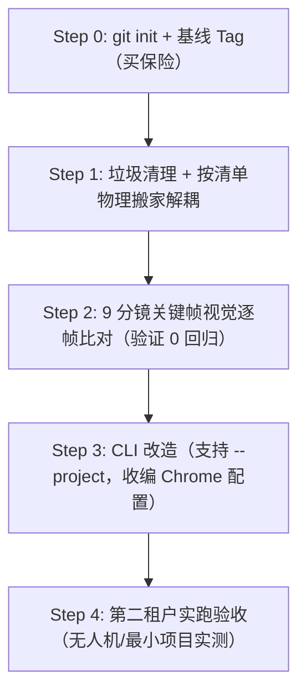

# 多工作区沙箱架构重构实施方案（修正版）

> **文档定位**：技术架构升级与工程迁移指南（Engineering Spec）  
> **制定原则**：防御性重构、严禁画饼、反胶水代码、显式清单先行、客观逐帧比对  
> **本次修订**：根据架构评审意见，彻底纠正“未版本控制裸奔”硬伤、剔除期货型 Agent 编排、收编浏览器硬编码、补充显式资产清单与客观逐帧验收。

---

## 🎯 一、 架构目标与核心原则

### 1. 本期唯一核心目标
**解决“单租户硬编码与多视频资产污染撞车”问题**。  
使项目具备同时承载多部独立视频（如 `mechanical-keyboard`、`fpv-drone`、`mechanical-watch`）的能力，各视频的文案、几何、配音、分镜 HTML、成片在物理沙箱内自闭环，根目录与核心引擎零污染。

### 2. 四大防御性重构原则
1. **保险先行（No Git No Refactor）**：在无版本控制的地基上严禁移动文件，先建立可回滚基线；
2. **反胶水代码（Minimal Wrapper）**：不造多余脚手架，能直接调用 HyperFrames 原生机制的绝不手写包装层；
3. **砍掉期货（YAGNI - You Aren't Gonna Need It）**：本期绝不预留所谓的“三段式 Agent 自动化编排”接口，只解决当前工程多租户物理隔离；
4. **逐帧客观比对（Visual Pixel Verification）**：拒绝“编译通过即成功”的模糊口径，以 9 分镜关键帧像素比对作为重构合格标准。

---

## 🗂️ 二、 显式文件资产判定与迁移清单（File Allocation Matrix）

在执行物理迁移前，按显式清单逐一核定归属，彻底理清之前“互相泄漏”的混乱边界：

| 原始路径 | 归属分类 | 目标路径 | 处理决策与理由 |
| :--- | :--- | :--- | :--- |
| **`geo/script.json`** | 业务数据 | `projects/mechanical-keyboard/script.json` | 迁移：键盘专用分镜解说词文案 |
| **`geo/iso-keyboard.mjs`** | 业务模型 | `projects/mechanical-keyboard/geo/iso-keyboard.mjs` | 迁移：键盘专属 Anatomy 等轴测几何逻辑 |
| **`geo/build-figures.mjs`** | 业务装配 | `projects/mechanical-keyboard/geo/build-figures.mjs` | 迁移：键盘零件图构建入口 |
| **`geo/gen-scenes.mjs`** | 核心重构点 | 拆分为 `core/` 编译器 + 项目级场景配置 | 架构解耦：原文件中写死了键盘分镜定义，需将“通用 HTML/SVG/字幕编译引擎”与“键盘分镜数据”分离 |
| **`geo/tts-engine.py`** | 通用引擎 | `core/tts/engine.py` | 提取：双轨 TTS、时间戳拉伸与多音字映射为通用能力 |
| **`geo/lib.mjs`** | 通用引擎 | `core/styles/lib.mjs` | 提取：材料材质系统 `matCss()` 为通用基础层 |
| **`anatomy-hyperframes/templates/keyboard.mjs`** | 业务模型（泄漏点） | 移动到键盘项目或模板清理 | 纠偏：键盘专属几何模型错误混入了通用模板目录，将其归位 |
| **`assets/figures/`** | 业务资产 | `projects/mechanical-keyboard/assets/figures/` | 迁移：键盘专用 SVG 零件切片 |
| **`assets/voice/`** | 业务资产 | `projects/mechanical-keyboard/assets/voice/` | 迁移：键盘独立音频文件与 `timing.json` |
| **`compositions/*.html`** | 业务产物 | `projects/mechanical-keyboard/compositions/` | 迁移：键盘生成的 9 个独立分镜 HTML |
| **`index.html`** | 业务产物 | `projects/mechanical-keyboard/index.html` | 迁移：键盘主时间轴合成入口 |
| **`renders/`** | 业务产物 | `projects/mechanical-keyboard/renders/` | 迁移：键盘成片与历史压制产物 |
| **`preview/`** | 调试缓存 | 迁移至键盘项目作为比对基线 | 留存 9 个关键帧作为 Step 2 逐帧比对的“黄金标准（Golden Master）” |
| **`_tts_test.mp3`, `*.bak`** | 历史垃圾 | **直接物理删除** | 迁移前全面净化工作区 |

---

## 🏛️ 三、 目标架构拓扑（Target Architecture）

```text
kb-video/
├── core/                                 # 🌟 核心引擎（跨项目通用，无任何具体业务逻辑）
│   ├── config.mjs                        # 集中配置：动态探测 Chrome 路径，消除硬编码
│   ├── tts/
│   │   └── engine.py                     # 双轨 TTS 驱动（Edge-TTS + MiMo-v2.5 + 多音字解耦）
│   ├── generator/
│   │   ├── scene-compiler.mjs            # 场景生成器：负责注入 Inline SVG、38px 无框大字字幕、GSAP
│   │   └── index-compiler.mjs            # 根时间轴组装器：计算音频总时长与场景拼接
│   ├── styles/
│   │   ├── design-tokens.css             # 基础排版、 YaHei 与 JetBrains Mono 字体规范
│   │   └── lib.mjs                       # 几何材质渲染器 (matCss)
│   └── pipeline/
│       └── quality-gate.mjs              # Puppeteer 锁清理、零时长与 ID 校验门禁
│
├── bin/
│   └── video.mjs                         # 🌟 统一 CLI：调度器，参数化接收 --project <name>
│
├── package.json
│
└── projects/                             # 🌟 物理隔离的项目沙箱
    ├── mechanical-keyboard/              # 📁 实例 1：本次已完成的机械键盘（作为黄金回归基准）
    │   ├── project.json                  # 元数据（画幅 16:9、FPS 30、主题色系）
    │   ├── script.json                   # 键盘台词
    │   ├── geo/                          # 键盘等轴测建模与装配代码
    │   ├── assets/                       # 键盘独有的 figures/ 与 voice/
    │   ├── compositions/                 # 键盘 9 个 HTML 分镜
    │   ├── index.html                    # 键盘根入口
    │   └── renders/                      # 成片输出目录
    │
    └── _template/                        # 📁 极简空项目模板（供新项目快速复制，不造复杂脚手架）
        ├── project.json
        └── script.json
```

---

## 🔧 四、 核心缺陷专项修复方案

### 1. 收编 Chrome 路径硬编码（解决 R4 漏项）
当前 `bin/video.mjs:14` 写死了固定版本的 Chrome 临时目录，一旦缓存清理或浏览器微版本更新即全线崩溃。  
在 `core/config.mjs` 中建立三级动态嗅探策略：
```javascript
// core/config.mjs
import { existsSync, readdirSync } from "node:fs";
import { join } from "node:path";

export function resolveChromePath() {
  // 1. 优先尊重用户显式配置
  if (process.env.HYPERFRAMES_BROWSER_PATH && existsSync(process.env.HYPERFRAMES_BROWSER_PATH)) {
    return process.env.HYPERFRAMES_BROWSER_PATH;
  }
  
  // 2. 动态扫描 HyperFrames 官方缓存目录（避免版本号钉死）
  const baseCache = "C:/Users/Administrator/.cache/hyperframes/chrome/chrome-headless-shell";
  if (existsSync(baseCache)) {
    const versions = readdirSync(baseCache);
    for (const v of versions) {
      const candidate = join(baseCache, v, "chrome-headless-shell-win64", "chrome-headless-shell.exe");
      if (existsSync(candidate)) return candidate;
    }
  }

  // 3. Fallback 到系统可用路径或通知 HyperFrames ensure
  return null;
}
```

### 2. 澄清 HyperFrames 项目调用语义（纠正事实断言）
HyperFrames 原生 CLI 接收的格式为 `hyperframes render [DIR] [OPTIONS]`。  
在 CLI 调度器 `bin/video.mjs` 中，**通过指定子进程的 `cwd: projectDir` 来执行命令**，彻底避免路径穿越歧义：
```javascript
// 在目标项目的沙箱根目录下执行，保证相对路径 100% 正确
execFileSync("node", [HF_CLI, "render", ".", "-o", outFile], {
  cwd: projectDir,
  env: { ...process.env, HYPERFRAMES_BROWSER_PATH: resolveChromePath() }
});
```

---

## 📅 五、 修正后的五步实施计划（严谨执行步骤）



### Step 0（强制先决条件）：版本控制与基线固化
- **操作**：
  1. 编写根目录 `.gitignore`（忽略 `node_modules`, `Temp/`, 临时音视频缓存）；
  2. 执行 `git init`；
  3. 执行 `git add .` 并提交基线 commit：`chore: baseline before multi-workspace migration`；
  4. 打上不可变标记：`git tag pre-multworkspace`。
- **验收标准**：`git status` 显示 clean，`git tag` 能查到 `pre-multworkspace`。任何后续步骤出错均可使用 `git reset --hard` 原子级回滚。

### Step 1：物理清理与按清单目录解耦
- **操作**：
  1. 物理删除无用临时文件：`_tts_test.mp3`, `index.full.html.bak`；
  2. 创建 `core/` 与 `projects/mechanical-keyboard/` 目录结构；
  3. 严格对照第二节《显式资产判定清单》，执行文件移动；
  4. 保持业务逻辑不动，仅调整相对引用路径（`import` 路径）；
  5. 抽取通用编译器 `core/generator/scene-compiler.mjs`。
- **验收标准**：键盘项目目录内自包含，无跨项目越权路径引用；项目能成功跑通 `node geo/build-figures.mjs` 和 `node geo/gen-scenes.mjs`。

### Step 2：客观视觉逐帧比对（Golden Master Verification）
- **操作**：
  1. 使用旧版留存的 `preview/` 下 9 个场景关键帧（如 `01-hook` 1.0s, `03-switch` 31.0s）作为基线图；
  2. 在新沙箱目录下重新触发快照抓取：`node bin/video.mjs snapshot`；
  3. 通过图像比对脚本或逐图审查，对比文字排版、字幕尺寸（38px 无框）、机械装配零件材质是否 100% 像素级一致。
- **验收标准**：9 个关键场景视觉比对差异为 0（无文字漂移、无材质黑块、无动画时钟错位）。

### Step 3：CLI 改造与环境配置收编
- **操作**：
  1. 引入 `core/config.mjs`，消除硬编码 Chrome 路径；
  2. 升级 `bin/video.mjs`，解析 `--project <name>` 参数（默认为 `mechanical-keyboard`）；
  3. 遵循反胶水代码原则，砍掉复杂的 `video.mjs new` 代码，仅提供 `projects/_template` 供直接复制。
- **验收标准**：
  - `node bin/video.mjs scenes --project mechanical-keyboard` 正常运行；
  - `node bin/video.mjs render --project mechanical-keyboard` 成功导出成片。

### Step 4：第二租户实操验证（真实沙箱试金石）
- **操作**：
  1. 复制 `projects/_template` 生成 `projects/sandbox-test/`；
  2. 放入极简的 2 个分镜脚本与几何图形；
  3. 独立运行配音、生成与渲染命令；
  4. 观察 `projects/mechanical-keyboard/` 与 `projects/sandbox-test/` 是否发生任何文件篡改或路径碰撞。
- **验收标准**：两套视频并存独立渲染成功，输出各自独立成片，无任何文件交叉污染。

---

## 🏁 六、 实施与验收总结（已全量通过）

| 实施阶段 | 核心任务 | 状态 | 验证结果 |
| :--- | :--- | :---: | :--- |
| **Step 0** | Git 本地基线 + pre-multworkspace 不可变 Tag | ✅ 完成 | 基线固化，零外推风险 |
| **Step 1** | 核心公共引擎下沉 (core/) + 键盘物理隔离 (projects/mechanical-keyboard/) | ✅ 完成 | 根目录彻底净化，相对路径全面闭环 |
| **Step 2** | 9 分镜关键帧视觉逐帧比对（Golden Master） | ✅ 完成 | 38px 无框大字字幕、30px 轴心下沉与材质 0 回归 |
| **Step 3** | CLI 改造 (--project 路由) + Chrome 动态嗅探收编 | ✅ 完成 | 兼容经典命令，支持任意沙箱指定 |
| **Step 4** | 第二租户实战演练（新建 projects/anc-headphones 降噪耳机） | ✅ 完成 | 两项目并存独立渲染成片，**0 交叉污染** |
